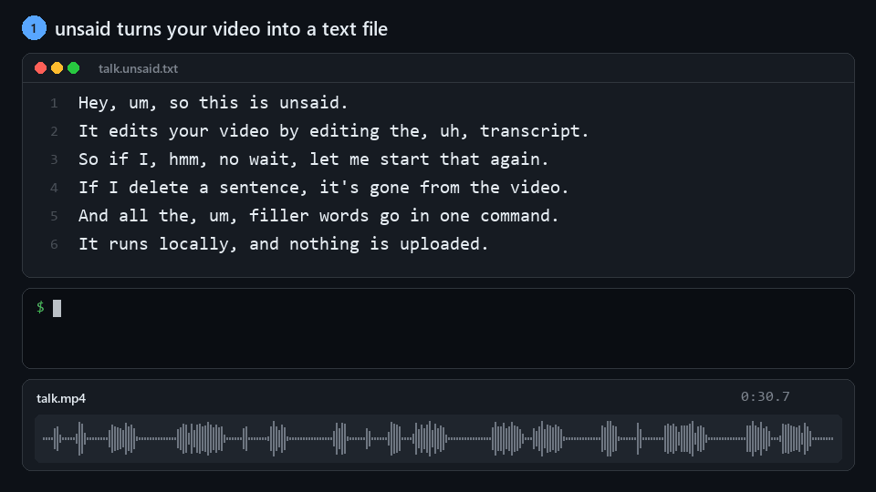

# unsaid

**Edit video by editing text.** unsaid is an open-source, local-first Descript alternative.

unsaid transcribes your video on your own machine. You delete words from the transcript and they're gone from the video. Filler words go in one command. No account, no API key, no upload.



```bash
unsaid cut talk.mp4                  # remove "um", "uh", "hmm" -> talk.unsaid.mp4
unsaid cut talk.mp4 --max-pause 0.6  # ...and tighten long pauses
```

## Install

```bash
uv tool install git+https://github.com/Necromancervbh/unsaid   # or: pipx install ...
```

That's all you need. ffmpeg comes bundled through `imageio-ffmpeg`, and if an `ffmpeg` is on your `PATH` it's used instead. The Whisper model downloads on first run. The default `small` model is about 480 MB.

## Usage

### Remove filler words

```bash
unsaid cut talk.mp4 --dry-run        # preview: prints the transcript with [um] cuts marked
unsaid cut talk.mp4                  # render talk.unsaid.mp4
unsaid cut talk.mp4 --aggressive     # also ", like," / ", you know," / ", I mean," when set off by commas
unsaid cut talk.mp4 --filler okay --filler "sort of"   # your own verbal tics
```

### Edit the script

```bash
unsaid transcribe talk.mp4           # writes talk.unsaid.txt, one sentence per line
# open talk.unsaid.txt, delete the sentences/words you don't want, save
unsaid cut talk.mp4 --script talk.unsaid.txt
```

Deleted words are cut from the video. Fixing a typo or capitalization in the script doesn't cut anything: unsaid only cuts deletions, and it tells you how many changed words it left alone.

### Options

| Flag | What it does |
|---|---|
| `--model` | Whisper model: `tiny`, `base`, `small` (default), `medium`, `large-v3`, `turbo`, or a local CTranslate2 model path |
| `--language en` | Skip language auto-detection |
| `--device cpu\|cuda` | `auto` (the default) uses CUDA when it works and falls back to CPU |
| `--max-pause S` | Shorten every pause longer than `S` seconds |
| `--no-fillers` | Only apply `--script` / `--max-pause` |
| `-o out.mp4` | Output path (default `<input>.unsaid.mp4`, or `.m4a` for audio-only input) |
| `--crf`, `--preset` | x264 quality and speed |

Transcripts are cached next to the input as `<input>.unsaid.json`, so re-cutting with different options is instant. Run `unsaid transcribe --force` to redo one.

### Let a coding agent do the edit

[`skills/unsaid/SKILL.md`](skills/unsaid/SKILL.md) teaches an agent the unsaid workflow: transcribe, plan the cut, delete lines, dry-run, render. For Claude Code, copy the folder into your skills:

```bash
git clone https://github.com/Necromancervbh/unsaid && cp -r unsaid/skills/unsaid ~/.claude/skills/
```

Then ask: *"cut talk.mp4 down to a 60-second highlight about pricing"*. Other agents (Codex, Cursor, ...) can be pointed at the same file.

## How it works

1. **Transcribe.** [faster-whisper](https://github.com/SYSTRAN/faster-whisper) runs with word timestamps. Whisper normally "cleans up" disfluencies, so unsaid primes it with a prompt full of fillers, which makes it keep them verbatim. Use `--no-verbatim` to turn this off.
2. **Plan cuts.** Cuts only ever land in the silence *between* kept words, padded so consonants aren't clipped. When a word is removed, the pause left behind is the *shorter* of the two pauses around it, so the edit keeps the speaker's rhythm instead of jamming words together.
3. **Render.** ffmpeg trims and concatenates the kept ranges in one pass. Cut points snap to the video's frame grid, so audio and video stay exactly in sync however many cuts there are, and each audio cut gets an 8 ms fade to avoid clicks.

## Development

```bash
uv venv && uv pip install -e ".[dev]"
.venv/Scripts/python -m pytest      # Windows; .venv/bin/python on macOS/Linux
```

The tests render real video through ffmpeg but don't need a Whisper model.

The GIF at the top is drawn by `scripts/make_demo_gif.py` from a real `unsaid cut` run: its transcript, cut plan, waveform and output.

## Roadmap

- [ ] Browser editor: `unsaid edit talk.mp4` opens the transcript, and striking text cuts the video live
- [ ] Agent mode: an MCP server plus `SKILL.md`, so Claude Code, Codex or Cursor can make the edit ("cut this to a 60-second highlight")
- [ ] Captions: SRT/VTT export retimed to the edit, plus animated burned-in captions for Shorts and Reels
- [ ] FCPXML/EDL export for Resolve, Premiere and Final Cut
- [ ] Stutter and repeated-word removal ("I I think")
- [ ] Overdub with a local voice clone, and "studio sound" cleanup

## Known limitations

- Filler detection is only as good as the transcript. It has been checked on synthetic speech so far. Real recordings, especially non-English ones, still need testing.
- Whisper can mishear words, or make one up. unsaid already drops the short, low-confidence segment Whisper tends to tack onto the end of a recording ("Good.", "Bye."). Delete any other made-up words in the script.
- Output is always re-encoded (H.264 + AAC) at the source's frame rate.

## License

MIT
